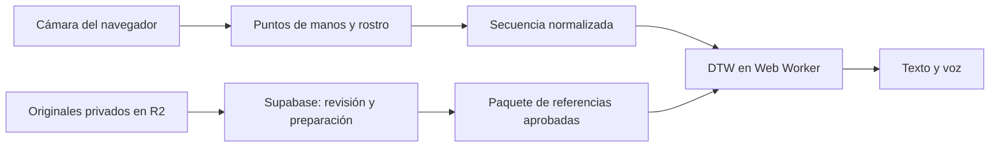

<div align="center">

# DeafApp 🤟

### Lengua de Señas Chilena, texto y voz


**[Abrir la web](https://deafapps.com)** · **[Interpretar en vivo](https://deafapps.com/interpretar)** · **[Grabar un aporte](https://deafapps.com/app)** · **[Administración](https://deafapps.com/admin)**

</div>

DeafApp es un proyecto de título de **Ingeniería en Informática de Duoc UC San Joaquín**. Buscamos apoyar intercambios breves entre personas sordas y oyentes mediante reconocimiento de Lengua de Señas Chilena (LSCh), con salida en texto y voz. También permite grabar aportes autorizados y revisarlos para ampliar las referencias del sistema.

El **interpretador en vivo ya está disponible como prototipo público**. Compara movimientos con una biblioteca preparada de muestras aprobadas. El vocabulario habilitado es limitado y puede cambiar a medida que se revisan los aportes.

## Estado actual

En la consulta del **10 de noviembre de 2026** comprobamos el siguiente estado del paquete público:

| Dato | Resultado |
| --- | --- |
| Palabras y oraciones habilitadas para interpretar | **58** |
| Referencias temporales del paquete | **353** |
| Revisión de datos | `368:210:103` |
| Preparación del paquete | Listo |
| Precisión general con personas nuevas | Pendiente de evaluación independiente |

Estas cifras describen esa consulta. La lista de **Interpretar en vivo** muestra el vocabulario utilizable en la versión que carga el navegador. Las referencias y las variantes sintéticas no equivalen a personas distintas.

DeafApp sigue en desarrollo. Su alcance actual es el reconocimiento de señas y oraciones habilitadas; la traducción abierta de LSCh y la generalización a distintas personas requieren más datos y validación. El proyecto es una herramienta de apoyo y no sustituye a intérpretes profesionales.

## Navegación

| Dirección | Qué permite |
| --- | --- |
| [deafapps.com](https://deafapps.com) | Conocer el proyecto y acceder a sus funciones. |
| [deafapps.com/interpretar](https://deafapps.com/interpretar) | Usar la cámara con texto, voz y vocabulario habilitado. |
| `/conversar` | Compartir una pantalla con señas reconocidas y respuestas escritas o dictadas. |
| `/tarjetas` | Mostrar mensajes grandes, leerlos con voz y guardar frases propias y favoritas. |
| [deafapps.com/app](https://deafapps.com/app) | Consultar el catálogo, grabar y revisar los aportes del dispositivo. |
| [deafapps.com/admin](https://deafapps.com/admin) | Acceder con autenticación a revisión, catálogo y entrenamiento. |
| [Privacidad](https://deafapps.com/privacidad) y [términos](https://deafapps.com/terminos) | Consultar las condiciones del proyecto. |
| [Tu autorización](https://deafapps.com/consentimiento) | Registrar las decisiones previas a una grabación. |

## Interpretador en vivo

### Conversación y comunicación rápida

**Conversar** reutiliza el interpretador del vocabulario habilitado y reúne las señas reconocidas con respuestas escritas o dictadas. El dictado se inicia con un botón, deja un borrador editable y requiere pulsar «Mostrar respuesta» para incorporarlo al historial. Al salir de la sección o esconder la pestaña se cancela la escucha. El historial se mantiene en memoria durante la sesión y puede limpiarse.

El dictado usa la API de reconocimiento de voz del navegador, cuando está disponible, en español de Chile. Puede requerir conexión y procesamiento del audio por el proveedor del navegador. DeafApp no guarda ni envía una grabación de este dictado a su backend. La escritura permanece disponible si no hay soporte o se deniega el micrófono. El dictado convierte voz en texto; no genera LSCh. La lectura de señas se pausa durante la escucha para evitar que el micrófono capte la voz de la aplicación.

**Comunicación rápida** ofrece tarjetas con mensajes predeterminados, categorías, búsqueda, favoritas y hasta 50 frases propias. Una tarjeta se puede mostrar a pantalla completa, editar para esa ocasión, leer con voz o usar como punto de partida para responder por escrito. Las frases propias y favoritas se conservan en `localStorage` de ese navegador; borrarlo elimina esas preferencias. Esta sección no solicita cámara ni micrófono.

Desde **Interpretar en vivo** se puede activar la cámara y realizar una seña sin seleccionar antes una respuesta esperada.

- Mostramos el resultado textual dentro del área de cámara y el estado de encuadre debajo.
- Los mensajes iniciales duran un tiempo limitado para dejar visible el movimiento.
- La salida de voz se puede activar, silenciar y probar. Ofrecemos voz de mujer u hombre cuando el dispositivo dispone de una voz en español compatible, además de la selección por nombre.
- El vocabulario aparece junto a los controles de voz, también en ancho móvil. Incluye etiquetas con sus tildes, como «mamá», «papá» y «cómo estás».
- El historial reúne las últimas coincidencias de la conversación y permite limpiarlas.

La cámara se procesa en el dispositivo: **el interpretador público no graba ni envía sus imágenes**. Al navegar a otras pantallas se pausa el reconocimiento y la voz; el aviso de sesión permite volver o apagar la cámara. Grabar o administrar libera el dispositivo para la cámara de esas funciones. Detenerla, cerrar la página o recargar termina la sesión de captura.

La voz depende del navegador y de las voces instaladas. Si no está disponible, se mantiene el resultado en texto. El prototipo público usa su paquete de referencias preparado y no requiere iniciar la API Python del laboratorio privado.

### Colores del vocabulario

Los niveles pueden actualizarse automáticamente mientras se interpreta, sin elegir una seña ni marcar cada resultado. Contamos **episodios de movimiento separados**, no cada fotograma de una misma seña.

| Mejor racha observada | Nivel |
| --- | --- |
| 5 detecciones consecutivas con movimientos separados | Alto, en verde |
| 3 o 4 | Medio, en amarillo |
| 1 o 2 | Bajo, en rojo |
| Sin detecciones registradas | Sin evaluar |

La mejor racha se conserva en este navegador para el modelo vigente. Los niveles asignados manualmente por administración mantienen la prioridad. También existen resultados de evaluación reservada cuando están disponibles. Las rachas miden consistencia de detección; **no son una precisión comprobada de LSCh**.

Implementación: [interpretador](src/app/LiveInterpretation.web.js), [rachas](src/training/liveRecognitionStability.js) y [niveles](src/training/recognitionQuality.js).

## Aportes y habilitación de señas

**Mostrar una seña para grabar y habilitarla para interpretar son decisiones distintas.**

### Catálogo para grabar

En **Administración → Habilitar señas** se pueden mostrar u ocultar categorías, cambiar señas individuales y crear nuevas entradas. No hace falta tener grabaciones ni publicar código para mostrar una seña en Grabar. El catálogo se actualiza desde el servidor.

Las oraciones se aportan en una sola toma. Sus etiquetas en español orientan la recopilación; la realización en LSCh necesita revisión lingüística y no presupone una traducción palabra por palabra.

### Interpretación con referencias aprobadas

1. Recibimos la grabación y queda pendiente de revisión.
2. Administración revisa el original. **Si aprueba una seña que todavía no tiene lotes, el servidor crea 50 variantes aprobadas**, vinculadas a esa muestra.
3. Una seña en recopilación puede habilitarse automáticamente como **prototipo** con **un original aprobado y apto más 50 variantes distintas aprobadas de originales aptos**, si su configuración permite esa activación.
4. El servidor prepara el paquete y el interpretador consulta su revisión para actualizar el modelo y el vocabulario.

Recibir una toma pendiente o rechazarla no crea variantes. Los lotes existentes, incluso pendientes o rechazados, conservan sus decisiones; las aprobaciones simultáneas no deben duplicar el lote automático. Retirar originales o variantes puede dejar una seña sin el mínimo necesario.

Las señas pausadas o reservadas para evaluación privada conservan su estado. Se mantiene la habilitación manual con el mínimo configurado de originales sin variantes, tres por defecto. Cumplir el mínimo de prototipo permite probar la seña; su precisión requiere una evaluación independiente.

En **Habilitar señas → Opciones de reconocimiento y entrenamiento** se revisan por separado las muestras aptas, las variantes, el estado del reconocimiento y su evaluación. Procedimiento completo: [Habilitar categorías y señas](docs/HABILITAR-SENAS.md).

### Flujo de grabación

| Paso | Comportamiento |
| --- | --- |
| Elegir una seña u oración | El catálogo se puede explorar sin abrir la cámara. |
| Revisar y autorizar | Registramos las decisiones antes de captar un aporte nuevo. |
| Preparar la cámara | En web confirmamos ambas manos durante 500 ms y mostramos la cuenta regresiva. |
| Realizar la seña | Capturamos 30 fotogramas y sus observaciones de seguimiento; se puede continuar con una o dos manos. |
| Revisar la toma | Permitimos reproducirla, repetirla, descartarla o mantener un borrador local. |
| Enviar | Transferimos el aporte autorizado y lo registramos como pendiente de revisión. |

La continuidad de manos tolera interrupciones breves, hasta 1,2 segundos desde la última detección válida. Una pérdida prolongada o un fallo del detector detiene la toma. Los puntos ausentes se conservan como ausentes. El borrador permite reintentar un envío sin duplicarlo cuando hay almacenamiento local disponible.

**Mis aportes** muestra el resumen de envíos de este dispositivo, no las decisiones de moderación ni cifras globales. Borrar los datos del navegador elimina ese resumen. Los votos públicos no conceden aprobación administrativa.

## Arquitectura y tecnologías



El diagrama resume la interpretación pública y la preparación de referencias. El envío voluntario de una grabación utiliza un flujo autorizado separado de la sesión del interpretador.

| Capa | Tecnología y uso |
| --- | --- |
| Aplicación | React Native 0.86, React 19.2.3 y Expo SDK 57, con versión web. |
| Interfaz web | Componentes DOM y CSS, Motion, OGL y Bricolage Grotesque. |
| Seguimiento | MediaPipe Face Mesh para rostro y TensorFlow.js con MediaPipe Hands en un Web Worker para manos. |
| Reconocimiento público | Comparación temporal DTW en JavaScript, con referencias aprobadas y reglas de aceptación. |
| Datos y servicios | Supabase: PostgreSQL, moderación, variantes, rasgos, RPC y funciones de preparación. |
| Originales | Cloudflare R2 privado, con lectura autorizada y comprobación de integridad. |
| Persistencia del navegador | IndexedDB para borradores, referencias en caché y herramientas experimentales. |
| Voz web | `speechSynthesis` y las voces disponibles del dispositivo. |
| Laboratorio privado | Backend Python con TensorFlow y MediaPipe, y candidatos experimentales del navegador. |
| Publicación web | GitHub Actions compila con Expo y publica por FTPS en HostGator. Cloudflare conserva un despliegue complementario y vistas previas. |

Los modelos de puntos de manos detectan geometría: no son por sí mismos modelos de LSCh. El motor público actual usa DTW. Las herramientas Conv1D, CNN y LSTM del laboratorio tienen sus propios datos e informes y no describen automáticamente el reconocimiento público.

### Almacenamiento y datos

Los originales actuales se guardan en **R2 privado**. La función `recording-upload` verifica el archivo antes de finalizar el registro del aporte. Supabase conserva los metadatos, las decisiones administrativas y el paquete preparado; el navegador público no descarga los originales para interpretar.

La tabla `grabaciones` conserva la etiqueta, categoría, ruta lógica, origen y versión de moderación. El archivo JSON incluye imágenes, puntos de seguimiento, tiempos, proporción del encuadre y comprobante de autorización. El idioma registrado es `csg`. Los códigos locales de origen no demuestran identidad ni personas distintas.

Supabase Storage se mantiene para compatibilidad y recuperación administrativa; el cliente actualizado no sube allí nuevas capturas. Ubicación, permisos y migración: [Almacenamiento privado en R2](docs/MIGRACION-ALMACENAMIENTO-R2.md).

## Metodología

Trabajamos con una **metodología ágil e iterativa**, incorporando avances incrementales. Partimos de una necesidad concreta, definimos el cambio, lo implementamos, comprobamos su resultado y volvemos a revisar la entrega.

Usamos **CRISP-DM** como referencia para comprender el problema y los datos, preparar las muestras, ajustar el reconocimiento, evaluar y desplegar. Un ejemplo fue automatizar las variantes al aprobar un original y después comprobar cómo afectaban a la habilitación de la seña. Otro fue revisar el interpretador por etapas para ajustar texto, voz y consulta del vocabulario.

La evaluación diferencia funcionamiento del software, consistencia de detección y precisión con muestras independientes. Las variantes sintéticas, las reproducciones de material de entrenamiento y las pruebas con entradas simuladas no demuestran generalización a personas nuevas.

## Administración y laboratorio privado

El acceso está en [deafapps.com/admin](https://deafapps.com/admin) y exige autenticación. El logo animado de todas las pantallas vuelve al inicio con un clic; también se puede usar con teclado. Su movimiento se desactiva cuando el dispositivo solicita movimiento reducido. No hace falta activar la cámara para administrar.

| Área | Función |
| --- | --- |
| Grabaciones | Buscar, reproducir y aprobar o rechazar aportes, individualmente o por lote. |
| Habilitar señas | Gestionar la visibilidad del catálogo y crear entradas para recopilar. |
| Opciones de reconocimiento y entrenamiento | Revisar originales y variantes aptas, cambiar estados y consultar niveles y evaluaciones. |
| Entrenamiento LSCh | Probar candidatos del navegador y el backend Python, con sus informes y muestras reservadas. |
| Material de LSCh y revisión de señas | Consultar referencias y revisar etiquetas y fragmentos antes de prepararlos para entrenamiento. |
| Datos y diagnóstico | Consultar cobertura, conexión y preparación. |

La sesión administrativa dura dos horas y permanece en memoria. Las operaciones comprueban sesión y versión para evitar sobrescribir una revisión reciente. Configuración y moderación: [admin/README.md](admin/README.md).

El laboratorio conserva candidatos personales, recuperación de grabaciones y una prueba Python de una seña por clip. El informe Python incluido corresponde a 19 clases de alimentos; no es la lista de señas del interpretador público. Los candidatos locales permanecen en su navegador o sesión según la herramienta. Entrenarlos no publica automáticamente una seña.

Guías del laboratorio: [integración Python](backend/INTEGRACION.md), [preparación de datos](training/README.md) y [vocabulario controlado](docs/VOCABULARIO-CONTROLADO.md).

## Privacidad y consentimiento

Consultar la web o interpretar en vivo no envía una grabación. Para **aportar** una toma, presentamos primero la autorización con finalidades separadas y sin casillas premarcadas. El comprobante acompaña al archivo y se vuelve a comprobar durante el envío.

- El aviso vigente es **2026-10-31-v2**. Los nuevos aportes autorizados bajo ese aviso registran **48 meses de calendario desde el envío** en la biblioteca privada. Los anteriores conservan el plazo autorizado.
- Retirar la autorización local exige autorizar de nuevo antes de otra captura. No borra por sí solo aportes enviados ni modelos entrenados.
- Registrar una fecha de vencimiento no ejecuta automáticamente la supresión remota. Las solicitudes y la eliminación de aportes corresponden al procedimiento del responsable.
- La prueba privada que consulta Python puede transmitir fotogramas al servidor configurado; tiene un alcance distinto del interpretador público que procesa en el dispositivo.

Avisos, responsabilidades y procedimiento: [Privacidad y consentimiento](docs/PRIVACIDAD-LEY-21719.md).

## Desarrollo local

Usar **Node.js 22.13 o posterior**, compatible con [Expo SDK 57](https://docs.expo.dev/versions/v57.0.0/), y ejecutar los comandos desde la raíz.

### Ramas y contribuciones

```bash
git checkout dev
git pull origin dev
git checkout -b feature/nombre-del-cambio
```

Trabajamos en `feature/*` o `fix/*` y abrimos un PR hacia **`dev`**. `master` solo recibe un PR aprobado desde `dev` y sus cambios publican la web. No hacemos commits directamente en `dev` ni en `master`. Flujo completo: [CONTRIBUTING.md](CONTRIBUTING.md) y [AGENTS.md](AGENTS.md).

### Iniciar la web

```bash
npm ci
npx expo start --web
```

`npm ci` instala las versiones del archivo de bloqueo y ejecuta el ajuste de compatibilidad de Expo Camera. Para comprobar la exportación:

```bash
npx expo export --platform web
node scripts/serve-web.cjs
```

Abrir [http://127.0.0.1:8081](http://127.0.0.1:8081). El servidor admite los enlaces directos de la aplicación, incluido `/interpretar`. La primera preparación de los detectores depende del equipo y de la conexión.

### Backend Python opcional

Para las herramientas privadas de Python se utiliza **Python 3.12**:

```bash
npm run backend:setup
npm run proyecto
```

En Windows también se puede abrir `iniciar-proyecto.bat`. El comando integrado inicia la API en `http://127.0.0.1:5000` y prepara o reutiliza la web del puerto 8081. `npm run backend`, `backend:check`, `backend:import`, `backend:train` y `backend:test` permiten trabajar con cada etapa por separado. Configuración: [backend/INTEGRACION.md](backend/INTEGRACION.md).

### Vista previa de privacidad

```bash
npm run web:privacy-preview
```

Abrir [http://localhost:8083/consentimiento](http://localhost:8083/consentimiento). Esta demostración permite revisar el formulario sin activar la cámara ni enviar aportes reales.

## Pruebas

| Comprobación | Comando |
| --- | --- |
| Interpretador, referencias, versiones y niveles | `node --test tests/liveInterpretation.test.mjs tests/liveRecognitionStability.test.mjs tests/preparedRecognition.test.mjs tests/recognitionQuality.test.mjs` |
| Variantes automáticas y habilitación | `node --test tests/recordingVariants.test.mjs` |
| Trazados y continuidad de manos | `node --test tests/handRegions.test.mjs tests/handRecovery.test.mjs tests/trackingContinuity.test.mjs tests/landmarkTracking.test.mjs tests/handWorkerAnatomy.test.mjs` |
| Etiquetas y voz | `node --test tests/phraseLabels.test.mjs tests/liveSignSpeech.test.mjs` |
| Administración y catálogo | `npm run test:admin` |
| Grabación y preparación | `npm run test:training` |
| Consentimiento y envío | `npm run test:privacy` y `npm run test:recording-upload` |
| Almacenamiento privado | `npm run test:storage-migration` |
| Laboratorio | `npm run test:model-training`, `npm run test:assistant` y `npm run test:python-backend` |

El **11 de noviembre de 2026** repetimos el comando de pruebas del interpretador y obtuvimos **38 aprobadas y 0 fallidas**. Los registros del 10 de noviembre incluyen además 14 aprobadas de variantes, 34 de trazados y 18 de etiquetas y voz, con cero fallos en esos grupos. Son comprobaciones del software, no porcentajes de acierto lingüístico. Las pruebas de cámara física y reconocimiento con personas nuevas necesitan su propia evaluación.

## Publicación

Cada cambio integrado en `master` activa [Deploy a HostGator](.github/workflows/deploy-hostgator.yml): instala dependencias, exporta la web con Expo, copia `deploy/.htaccess` y publica `dist/` completa por FTPS. Las credenciales pertenecen a los secretos del repositorio.

**`deploy/.htaccess` debe permanecer versionado y no agregarse al `.gitignore`.** Configura las rutas, HTTPS y las cabeceras de la web. La configuración complementaria de Cloudflare está en [wrangler.jsonc](wrangler.jsonc) y [public/_redirects](public/_redirects).

El proyecto contiene configuración nativa de Expo y un perfil Android de vista previa en [eas.json](eas.json). La verificación del sitio en ancho móvil no equivale a validar una APK en un teléfono físico.

## Código y documentación

| Carpeta o archivo | Contenido |
| --- | --- |
| [App.js](App.js) y [src/app/](src/app/) | Entrada, navegación, bienvenida e interpretador. |
| [src/camera/](src/camera/) y [public/](public/) | Cámara, detectores, modelos de seguimiento y trazados. |
| [src/training/](src/training/) | Referencias preparadas, inferencia, variantes, niveles y entrenamiento del navegador. |
| [src/admin/](src/admin/) | Revisión de aportes, catálogo y herramientas privadas. |
| [src/recording/](src/recording/) y [src/privacy/](src/privacy/) | Grabación, borradores, envío y consentimiento. |
| [supabase/](supabase/) | Migraciones y funciones de datos, almacenamiento y reconocimiento. |
| [backend/](backend/) | API y entrenamiento Python del laboratorio. |
| [training/](training/) | Preparación de datos, fuentes y herramientas experimentales. |
| [tests/](tests/) y [scripts/](scripts/) | Pruebas y utilidades del proyecto. |
| [Capstone/](Capstone/) | Guías, diarios y entregables académicos del Proyecto APT. |
| [docs/README.md](docs/README.md) | Índice de las guías técnicas. |
| [archive/](archive/) | Prototipos y exportaciones anteriores que no se usan para compilar. |

Guías para los avances recientes: [habilitación de señas](docs/HABILITAR-SENAS.md), [reconocimiento y vocabulario](docs/VOCABULARIO-CONTROLADO.md), [trazados](docs/TRAZADOS.md) y [originales privados en R2](docs/MIGRACION-ALMACENAMIENTO-R2.md).

## Participación y revisión lingüística

La pertinencia de una seña y sus variantes regionales debe revisarse con la comunidad sorda. Conservamos las etiquetas y la procedencia para poder corregir decisiones sin imponer una realización única. Consultar material educativo o encontrar videos en internet no concede por sí solo autorización para usarlos en entrenamiento.

## Autores

| Integrante | Participación |
| --- | --- |
| **Diego Armando Padilla Serrano** | Autor y desarrollador principal del proyecto. |
| **Ignacio Hernández** | Colaborador del proyecto. |
| **Felipe Crisóstomo** | Colaborador del proyecto. |

## Licencia

Los aportes originales de **Diego Armando Padilla Serrano**, autor y desarrollador principal, se reservan bajo la [licencia propietaria](LICENSE). Este aviso no concede una licencia de código abierto sobre sus aportes ni transfiere los derechos de colaboradores o terceros.

El uso institucional se formaliza mediante un contrato separado de suscripción o licencia y las autorizaciones de los titulares pertinentes. Este repositorio no concede por sí solo una licencia comercial sobre el conjunto de DeafApp.

Las dependencias y demás materiales de terceros mantienen sus licencias. Se conservan el aviso [MIT de Expo](licenses/Expo-MIT.txt), las atribuciones de [ui/NOTICE.md](src/ui/NOTICE.md), las condiciones de [React Bits](src/ui/LICENSE-react-bits.md) y los avisos incluidos con los modelos, tipografías y fuentes de datos. Esta reserva no revoca permisos válidamente concedidos sobre versiones anteriores.
